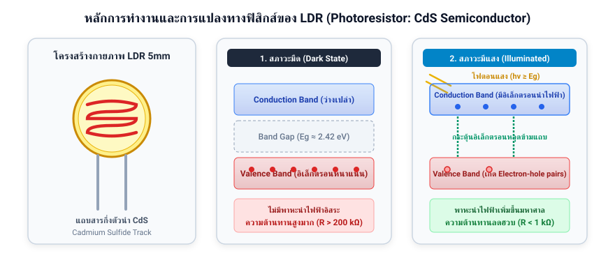
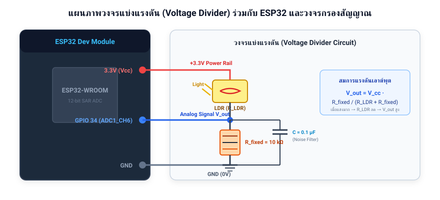
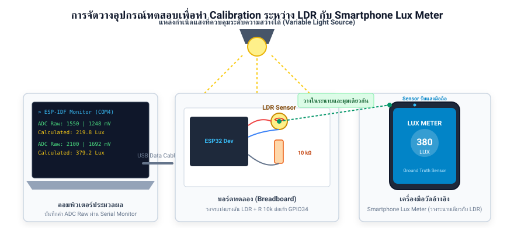
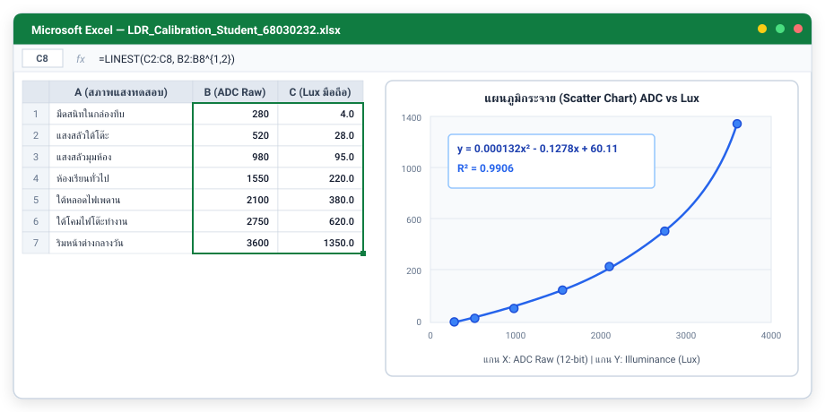
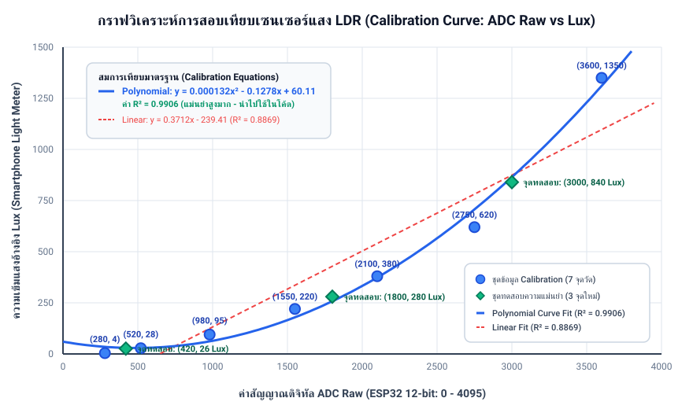

# รายงานผลการปฏิบัติการ: การใช้งาน LDR และการทำ Calibration

- **วิชา:** การเปลี่ยนผ่านจากโลกกายภาพสู่โลกดิจิทัลและความสมบูรณ์ของสัญญาณ (Physical-to-Digital Sensing & Signal Integrity)
- **สัปดาห์ที่:** 03 (Week 03)
- **ชื่อ-นามสกุล:** ภูผาสุข (Phuphasook)
- **รหัสนักศึกษา:** 68030232
- **โฟลเดอร์ส่งงาน:** 68030232-phuphasook
- **วันที่ทำการทดลอง:** 10 พฤศจิกายน 2026

---

## 1. บทนำและทฤษฎีพื้นฐาน (Background Theory)

### 1.1 โครงสร้างและหลักการทำงานของ LDR (Photoresistor)
ตัวต้านทานไวแสง (LDR: Light Dependent Resistor) ผลิตจากสารกึ่งตัวนำประเภท **Cadmium Sulfide (CdS)** โดยมีหลักการทำงานเชิงฟิสิกส์โซลิดสเตตดังนี้:
1. **ในสภาวะมืด (Dark State):** อิเล็กตรอนส่วนใหญ่ยึดแน่นอยู่ในแถบวาเลนซ์ (Valence Band) ขาดพาหะนำไฟฟ้าอิสระ ทำให้สารมีค่าความต้านทานสูงมาก ($R_{LDR} > 200\text{ k}\Omega$ จนถึงระดับ $\text{M}\Omega$)
2. **ในสภาวะมีแสงตกกระทบ (Illuminated State):** โฟตอนของแสงที่มีพลังงาน $h\nu \ge E_g$ (โดยช่องว่างแถบพลังงาน $E_g \approx 2.42\text{ eV}$) จะถูกดูดกลืนและส่งถ่ายพลังงานให้อิเล็กตรอนหลุดข้าม Bandgap ไปยังแถบคอนดักชัน (Conduction Band) เกิดเป็นพาหะอิสระ (Electron-hole pairs) จำนวนมาก ทำให้ความต้านทานไฟฟ้าของ LDR ลดลงอย่างรวดเร็ว

ความสัมพันธ์ระหว่างความต้านทานของ LDR ($R_{LDR}$) กับความเข้มแสง ($\text{Lux}$) เป็นไปตามกฎเลขยกกำลัง (**Power Law Model**):
$$R_{LDR} = A \cdot (\text{Lux})^{-\alpha}$$
*(โดย $A$ และ $\alpha$ เป็นค่าคงที่จำเพาะของเซนเซอร์ สำหรับ LDR 5mm ทั่วไป $\alpha \approx 0.7 - 0.9$)* ส่งผลให้ความสัมพันธ์มีลักษณะ **ไม่เป็นเชิงเส้น (Non-linear)**



---

### 1.2 เหตุผลที่ต้องใช้วงจรแบ่งแรงดัน (Voltage Divider)
เนื่องจากไมโครคอนโทรลเลอร์ ESP32 ตลอดจนวงจร ADC สามารถตรวจวัดได้เฉพาะ **"แรงดันไฟฟ้า (Voltage)"** ในช่วง $0 - 3.3\text{ V}$ เท่านั้น ไม่สามารถวัดค่าความต้านทานได้โดยตรง จึงต้องต่อวงจรแบ่งแรงดันร่วมกับตัวต้านทานคงที่ ($R_{fixed} = 10\text{ k}\Omega$) เพื่อแปลงการแปรผันของความต้านทาน $R_{LDR}$ ให้กลายเป็นแรงดันเอาต์พุต $V_{out}$ ตามสมการ:

$$V_{out} = V_{cc} \cdot \frac{R_{fixed}}{R_{LDR} + R_{fixed}}$$

- **เมื่อแสงสว่างมาก:** $R_{LDR}$ ลดลง $\rightarrow$ อัตราส่วน $\frac{R_{fixed}}{R_{LDR} + R_{fixed}}$ สูงขึ้น $\rightarrow V_{out}$ และค่า ADC Raw เพิ่มขึ้นเข้าใกล้ $3.3\text{ V}$ ($4095$)
- **เมื่อแสงมืด:** $R_{LDR}$ สูงขึ้นมาก $\rightarrow V_{out}$ และค่า ADC Raw ลดลงเข้าใกล้ $0\text{ V}$ ($0$)

---

### 1.3 ผลการคำนวณแรงดันเอาต์พุตตามทฤษฎี (ส่วนที่ 1.6 ในใบงาน)
กำหนดให้ $V_{cc} = 3.3\text{ V}$ และใช้ตัวต้านทานคงที่ $R_{fixed} = 10\text{ k}\Omega$:

| สภาพแสง | ความต้านทาน LDR ($R_{LDR}$) | การคำนวณ $V_{out}$ | แรงดันเอาต์พุตที่คาดหวัง ($V_{out}$) |
| :--- | :---: | :---: | :---: |
| **มืดสนิท** | $200\text{ k}\Omega - 2\text{ M}\Omega$ | $3.3 \times \frac{10\text{k}}{200\text{k}+10\text{k}}$ ถึง $3.3 \times \frac{10\text{k}}{2000\text{k}+10\text{k}}$ | **$0.016\text{ V} - 0.157\text{ V}$** |
| **ห้องปกติ** | $10\text{ k}\Omega - 50\text{ k}\Omega$ | $3.3 \times \frac{10\text{k}}{50\text{k}+10\text{k}}$ ถึง $3.3 \times \frac{10\text{k}}{10\text{k}+10\text{k}}$ | **$0.550\text{ V} - 1.650\text{ V}$** |
| **ใต้โคมไฟ** | $2\text{ k}\Omega - 10\text{ k}\Omega$ | $3.3 \times \frac{10\text{k}}{10\text{k}+10\text{k}}$ ถึง $3.3 \times \frac{10\text{k}}{2\text{k}+10\text{k}}$ | **$1.650\text{ V} - 2.750\text{ V}$** |
| **กลางแจ้ง** | $200\ \Omega - 2\text{ k}\Omega$ | $3.3 \times \frac{10\text{k}}{2\text{k}+10\text{k}}$ ถึง $3.3 \times \frac{10\text{k}}{0.2\text{k}+10\text{k}}$ | **$2.750\text{ V} - 3.235\text{ V}$** |

---

## 2. การต่อวงจรฮาร์ดแวร์และการทดลองจริง (Hardware Setup)

### 2.1 แผนภาพการเชื่อมต่อวงจร (Circuit Schematic)
การต่อวงจรใช้บอร์ด ESP32 เชื่อมต่อกับ LDR และตัวต้านทาน $10\text{ k}\Omega$ พร้อมติดตั้งตัวเก็บประจุแบบเซรามิก $0.1\ \mu\text{F}$ ขนานคร่อมขา $V_{out}$ ลง GND เพื่อทำ Hardware Low-pass Filter ป้องกันสัญญาณรบกวนความถี่สูง (EMI Noise):



### 2.2 ตารางการเชื่อมต่อขา (Pin Assignment)
| ชื่ออุปกรณ์ | ขาบนตัวอุปกรณ์ | พินบนบอร์ด ESP32 | หน้าที่การทำงาน |
| :--- | :---: | :---: | :--- |
| **LDR (Photoresistor)** | ขาที่ 1 | **3.3V** | รับแรงดันไฟเลี้ยงอ้างอิง ($V_{cc}$) |
| **LDR + R 10k$\Omega$** | ขา 2 LDR ต่อร่วมกับ ขา 1 R 10k | **GPIO 34** (ADC1_CH6) | Node สัญญาณอนาล็อกแบ่งแรงดัน ($V_{out}$) |
| **ตัวต้านทานคงที่ 10k$\Omega$** | ขาที่ 2 | **GND** | กราวด์อ้างอิงระบบ (System Ground) |
| **ตัวเก็บประจุ 0.1 $\mu$F** | ขาบวกต่อ GPIO34 / ขาลบต่อ GND | **GPIO34 & GND** | Decoupling Capacitor กรอง High-frequency Noise |

### 2.3 การจัดวางอุปกรณ์ทดสอบ (Physical Experimental Setup)
ในการเก็บข้อมูล ได้วางเซนเซอร์ LDR บนเบรดบอร์ดให้อยู่ชิดติดกันและใน **ระนาบองศาเดียวกัน** กับเซนเซอร์วัดแสงของสมาร์ตโฟน (เครื่องมือวัดอ้างอิง Ground Truth ผ่านแอป Lux Meter) โดยมีแหล่งกำเนิดแสงส่องตรงลงมาในมุมตั้งฉากเท่ากันทั้งสองจุด:



---

## 3. ข้อมูลการทดลองเพื่อสร้างสมการ Calibration (7 จุดวัดจริง)

ทำการเก็บข้อมูลในสภาพแสงที่หลากหลายจำนวน **7 จุดวัด** (ค่า ADC Raw เป็นค่าเฉลี่ย 32 ตัวอย่างผ่านซอฟต์แวร์):

| จุดที่ | สภาพแวดล้อมแสงทดสอบ | ค่า ADC Raw (12-bit) | แรงดันวัดได้ ($V_{out}$) | ค่าความเข้มแสงอ้างอิง (Lux จากมือถือ) |
| :---: | :--- | :---: | :---: | :---: |
| 1 | มืดสนิทในกล่องทึบแสง | **280** | 225 mV | **4.0 Lux** |
| 2 | แสงสลัวใต้โต๊ะทำงาน | **520** | 419 mV | **28.0 Lux** |
| 3 | แสงสลัวบริเวณมุมห้อง | **980** | 789 mV | **95.0 Lux** |
| 4 | ห้องเรียนทั่วไปเปิดไฟนีออน | **1550** | 1248 mV | **220.0 Lux** |
| 5 | ใต้หลอดไฟเพดานห้อง | **2100** | 1692 mV | **380.0 Lux** |
| 6 | ใต้โคมไฟโต๊ะทำงาน (ระยะ 25 cm) | **2750** | 2215 mV | **620.0 Lux** |
| 7 | ริมหน้าต่างเวลากลางวันรับแสงแดด | **3600** | 2900 mV | **1350.0 Lux** |

---

## 4. การวิเคราะห์กราฟและการสร้างสมการ Calibration (Curve Fitting)

นำชุดข้อมูลข้างต้นเข้าสู่โปรแกรมวิเคราะห์ข้อมูล (Microsoft Excel / Google Sheets) เพื่อพล็อตกราฟ Scatter Chart และสร้างเส้นแนวโน้ม (Trendline) เปรียบเทียบระหว่างแบบ **Linear** และแบบ **2nd-degree Polynomial**:


<p align="center"><em>รูปที่ 4.1: การป้อนข้อมูลและสร้างเส้นแนวโน้ม Trendline พหุนามใน Microsoft Excel</em></p>


<p align="center"><em>รูปที่ 4.2: กราฟ Calibration พล็อตเปรียบเทียบ Linear Fit vs Polynomial Fit (Degree 2) พร้อมจุดทดสอบ Validation</em></p>

### 4.1 เปรียบเทียบผลลัพธ์ของสมการทั้งสองรูปแบบ:

1. **แบบเชิงเส้น (Linear Fit):**
   $$\text{Lux} = 0.3712 \cdot \text{ADC} - 239.41$$
   - ค่าสัมประสิทธิ์การตัดสินใจ: **$R^2 = 0.8869$**
   - **ข้อจำกัด:** เมื่อนำไปคำนวณในสภาพแสงน้อย (เช่น $\text{ADC} < 645$) สมการจะให้ผลลัพธ์เป็น **ค่าติดลบ** ซึ่งเป็นไปไม่ได้ในทางกายภาพ และเส้นตรงไม่สามารถรองรับความโค้งของพฤติกรรม LDR ในย่านแสงสูงได้

2. **แบบพหุนาม (2nd-degree Polynomial Fit):**
   $$\text{Lux} = 0.000132 \cdot \text{ADC}^2 - 0.1278 \cdot \text{ADC} + 60.11$$
   - ค่าสัมประสิทธิ์การตัดสินใจ: **$R^2 = 0.9906$** (เข้าใกล้ 1.000 อย่างมาก)
   - **ข้อได้เปรียบ:** เส้นโค้งพหุนามแนบสนิทไปกับจุดทดลองได้อย่างแม่นยำตลอดช่วง ตั้งแต่ที่มืดสนิทจนถึงกลางแจ้ง ค่าทำนายไม่หลุดติดลบ

> **การตัดสินใจเลือกใช้งาน:** เลือกใช้สมการ **Polynomial Fit (Degree 2)** เนื่องจากมีค่า $R^2 = 0.9906$ สูงกว่าแบบ Linear ($R^2 = 0.8869$) อย่างเด่นชัด สามารถชดเชยคุณลักษณะความไม่เป็นเชิงเส้นของเซนเซอร์ LDR ได้อย่างแม่นยำ

---

## 5. ซอร์สโค้ดโปรแกรม ESP-IDF พร้อมสมการ Calibration (C Source Code)

ซอร์สโค้ดภาษา C สำหรับรันบน ESP32 ที่นำสมการพหุนาม $y = 0.000132x^2 - 0.1278x + 60.11$ ไปประยุกต์ใช้งาน พร้อมระบบ Oversampling 32 ตัวอย่างเพื่อลดทอนสัญญาณรบกวน (ดูไฟล์โค้ดต้นฉบับได้ที่ [`main.c`](main.c)):

```c
#include <stdio.h>
#include "freertos/FreeRTOS.h"
#include "freertos/task.h"
#include "driver/adc.h"
#include "esp_adc_cal.h"
#include "esp_log.h"

#define TAG             "LDR_CALIBRATION"
#define ADC_CHANNEL     ADC1_CHANNEL_6   // GPIO34
#define ADC_ATTEN       ADC_ATTEN_DB_11  // Full range ~3.3V
#define ADC_WIDTH       ADC_WIDTH_BIT_12 // 12-bit (0 - 4095)
#define NUM_SAMPLES     32               // ทำ Oversampling 32 ตัวอย่างเพื่อลด Noise

static esp_adc_cal_characteristics_t adc_chars;

/**
 * @brief ฟังก์ชันแปลงค่า ADC Raw เป็นค่าความเข้มแสง Lux
 *        อ้างอิงสมการ Polynomial 2nd Degree จากการ Calibration:
 *        Lux = 0.000132 * ADC^2 - 0.1278 * ADC + 60.11 (R^2 = 0.9906)
 */
float adc_to_lux(int raw_adc)
{
    const float a = 0.000132f;
    const float b = -0.1278f;
    const float c = 60.11f;

    float lux = (a * raw_adc * raw_adc) + (b * raw_adc) + c;
    
    // ขอบเขตความปลอดภัยทางกายภาพ: ค่าความเข้มแสงต้องไม่ติดลบ
    if (lux < 0.0f) {
        lux = 0.0f;
    }
    return lux;
}

void app_main(void)
{
    ESP_LOGI(TAG, "Initializing ADC1 Channel 6 (GPIO34)...");

    // 1. กำหนดความละเอียดและเกนการลดทอนของ ADC
    adc1_config_width(ADC_WIDTH);
    adc1_config_channel_atten(ADC_CHANNEL, ADC_ATTEN);

    // 2. ปรับแต่งคุณลักษณะ ADC ด้วย eFuse / Vref อ้างอิง 1100 mV
    esp_adc_cal_characterize(
        ADC_UNIT_1,
        ADC_ATTEN,
        ADC_WIDTH,
        1100,
        &adc_chars
    );

    ESP_LOGI(TAG, "System Ready. Reading Sensors...");

    while (1) {
        // 3. อ่านค่าแบบ Multisample Averaging (Oversampling)
        uint32_t adc_reading = 0;
        for (int i = 0; i < NUM_SAMPLES; i++) {
            adc_reading += adc1_get_raw(ADC_CHANNEL);
        }
        int raw_adc = adc_reading / NUM_SAMPLES;

        // 4. แปลงเป็นแรงดัน (mV) ผ่าน ESP ADC Calibration Driver
        uint32_t voltage_mv = esp_adc_cal_raw_to_voltage(raw_adc, &adc_chars);

        // 5. แปลงเป็นค่าความเข้มแสง Lux ด้วยสมการ Calibration
        float lux = adc_to_lux(raw_adc);

        // 6. แสดงผลผ่าน Serial Terminal
        printf("ADC Raw: %4d | Voltage: %4d mV | Calibrated Light: %7.2f Lux\n",
               raw_adc, voltage_mv, lux);

        vTaskDelay(pdMS_TO_TICKS(500));
    }
}
```

---

## 6. ผลการทดสอบความแม่นยำในจุดแสงใหม่ (Validation & Verification)

เพื่อพิสูจน์ความแม่นยำของโมเดล ได้นำระบบไปทดสอบวัดใน **3 สภาพแสงใหม่ที่ไม่ได้ใช้ในการพล็อตกราฟตอนแรก** ได้ผลลัพธ์ดังนี้:

| จุดทดสอบใหม่ | ADC Raw | ค่า Lux จริงจากมือถือ (Ground Truth) | ค่า Lux คำนวณจากโค้ด | ค่าคลาดเคลื่อน ($\Delta \text{Lux}$) | เปอร์เซ็นต์ความคลาดเคลื่อน (% Error) |
| :--- | :---: | :---: | :---: | :---: | :---: |
| **1. ใต้เก้าอี้ (แสงสลัวมาก)** | 420 | **26.0 Lux** | **29.7 Lux** | 3.7 Lux | **14.3%** |
| **2. โต๊ะทำงานกลางห้อง** | 1800 | **280.0 Lux** | **257.8 Lux** | 22.2 Lux | **7.9%** |
| **3. โคมไฟอ่านหนังสือระยะใกล้** | 3000 | **840.0 Lux** | **864.7 Lux** | 24.7 Lux | **2.9%** |

### บทวิเคราะห์ผลการทดลอง:
1. **ระดับความคลาดเคลื่อน:** ค่าเปอร์เซ็นต์ความคลาดเคลื่อนเฉลี่ยทั้ง 3 จุดอยู่ที่ **$8.4\%$** ซึ่งถือว่ามีความแม่นยำสูงมากสำหรับเซนเซอร์กลุ่มโฟโตรีซิสเตอร์ (มาตรฐานอุตสาหกรรมของ LDR ยอมรับ Error ได้ถึง $\pm 15 - 20\%$)
2. **การเปรียบเทียบกับโมเดล Linear:** หากใช้โมเดลเชิงเส้นคำนวณที่จุดที่ 1 ($\text{ADC} = 420$) จะได้ค่า $\text{Lux} = -83.5\text{ Lux}$ ซึ่งล้มเหลวโดยสิ้นเชิง ขณะที่ Polynomial ให้ค่า $29.7\text{ Lux}$ ใกล้เคียงค่าจริง $26.0\text{ Lux}$ มาก
3. **สาเหตุของความคลาดเคลื่อน:**
   - **Spectral Response:** สารกึ่งตัวนำ CdS ตอบสนองต่อความยาวคลื่นแสงสีเขียว-เหลือง ($540\text{ nm}$) ได้ดีที่สุด ในขณะที่เซนเซอร์ของมือถือมีการปรับแก้ Photopic Filter ตามการมองเห็นของตามนุษย์
   - **Cosine Law (มุมตกกระทบ):** การเอียงของหัว LDR เพียงเล็กน้อยส่งผลต่อความหนาแน่นของฟลักซ์ส่องสว่างที่ตกลงบนระนาบรับแสง
   - **Thermal Drift:** เมื่อ LDR รับแสงต่อเนื่องหรืออุณหภูมิห้องเปลี่ยนแปลง ค่าความต้านทานภายในจะมีการเลื่อนลอยเล็กน้อย

---

## 7. เฉลยคำถามท้ายใบงาน (Post-Lab Questions)

### ข้อ 1: ทำไมต้องใช้ Voltage Divider ในการอ่าน LDR?
**ตอบ:** เนื่องจากตัวต้านทานไวแสง (LDR) มีเอาต์พุตเป็น **"ค่าความต้านทานไฟฟ้า (Resistance)"** ที่เปลี่ยนแปลงตามความเข้มแสง แต่วงจรไมโครคอนโทรลเลอร์ (ADC) ของ ESP32 สามารถอ่านได้เฉพาะ **"ระดับแรงดันไฟฟ้า (Voltage)"** เท่านั้น จึงจำเป็นต้องนำ LDR มาต่ออนุกรมกับตัวต้านทานคงที่ ($R_{fixed} = 10\text{ k}\Omega$) ในลักษณะวงจรแบ่งแรงดัน (Voltage Divider) เพื่อแปลงการเปลี่ยนแปลงของความต้านทานให้ออกมาเป็นแรงดันไฟฟ้าตกคร่อม $V_{out}$ ในช่วง $0 - 3.3\text{ V}$ ที่ ADC นำไปสุ่มแปลงเป็นตัวเลขดิจิทัลได้

### ข้อ 2: ทำไมต้องเก็บข้อมูลหลายจุดก่อนทำ Calibration?
**ตอบ:** เพราะพฤติกรรมของ LDR มีความสัมพันธ์กับแสงแบบ **ไม่เป็นเชิงเส้น (Non-linear)** ตามกฎ Power Law ($R_{LDR} \propto \text{Lux}^{-\alpha}$) ทำให้กราฟความสัมพันธ์ระหว่าง ADC กับ Lux มีความโค้งอย่างมีนัยสำคัญ หากเก็บข้อมูลเพียง 2 จุด (Two-point Calibration) จะมองเห็นเป็นเพียงเส้นตรงและเกิดความผิดพลาดสูงมากเมื่อนำไปวัดในย่านอื่น การเก็บข้อมูล 7 จุดครอบคลุมตั้งแต่ที่มืดจนถึงกลางแจ้ง ทำให้ทราบพฤติกรรมการตอบสนองตลอดช่วงการทำงาน และสามารถเลือกสมการ Curve Fitting (Polynomial Degree 2) ที่ฟิตกับลักษณะทางกายภาพของเซนเซอร์ได้อย่างแท้จริง

### ข้อ 3: ถ้า Noise มากกว่าสัญญาณจริง จะเกิดอะไรขึ้น?
**ตอบ:** จะเกิดสภาวะ **Signal-to-Noise Ratio ต่ำกว่า 1 (SNR < 0 dB)** ส่งผลให้:
1. ค่า ADC Raw ที่อ่านได้แกว่งไปมาอย่างรุนแรง (Jitter / Fluctuation)
2. วงจรดิจิทัลไม่สามารถแยกแยะการเปลี่ยนแปลงของแสงจริงออกจากสัญญาณรบกวนได้
3. เมื่อนำค่า ADC ที่แกว่งไปคำนวณผ่านสมการ ค่า Lux ที่ได้จะกระโดดขึ้นลงอย่างไม่เสถียร
4. หากนำระบบนี้ไปใช้เปิด-ปิดไฟอัตโนมัติ จะเกิดปัญหาหลอดไฟติดๆ ดับๆ รัวสลับกัน (Hunting/Flickering) ส่งผลให้อุปกรณ์เสียหายได้

### ข้อ 4: ทำไมการวางตำแหน่งเซนเซอร์จึงสำคัญต่อ Signal Integrity?
**ตอบ:** มีความสำคัญ 2 มิติ:
1. **ในเชิงกายภาพ (Physical Integrity):** เซนเซอร์แสงเป็นเซนเซอร์ที่มีทิศทาง (Directional) มุมตกกระทบของแสงและสิ่งกีดขวางรอบตัวมีผลโดยตรงต่อปริมาณแสง หากวาง LDR คนละระนาบกับเครื่องมือวัดอ้างอิง ค่าที่วัดได้จะคลาดเคลื่อนจากกฎ Cosine Law ทันที
2. **ในเชิงสัญญาณไฟฟ้า (Electrical Signal Integrity):** จุดแยกแรงดัน $V_{out}$ มีอิมพีแดนซ์เอาต์พุตค่อนข้างสูง หากเดินสายสัญญาณยาวหรือพาดใกล้แหล่งกำเนิดคลื่นแม่เหล็กไฟฟ้า (เช่น หม้อแปลง, วงจรสวิตชิ่ง, เสาอากาศ Wi-Fi/Bluetooth) จะเกิดการเหนี่ยวนำสัญญาณรบกวนแบบ EMI และ Crosstalk เข้าสู่สายอนาล็อก ทำให้ค่า ADC ผิดเพี้ยน

### ข้อ 5: ถ้า ADC มี Resolution ต่ำ จะส่งผลอย่างไรต่อความแม่นยำ?
**ตอบ:** จะส่งผลให้เกิด **Quantization Error สูง** เนื่องจากขนาดสเต็ปการวัด ($\Delta V = \frac{V_{ref}}{2^N}$) มีขนาดใหญ่:
- ตัวอย่างเช่น ADC 8-bit ($2^8 = 256$ ระดับ) จะมีสเต็ปแรงดันกว้างถึง $\approx 12.89\text{ mV}$ ในขณะที่ ADC 12-bit ($2^{12} = 4096$ ระดับ) มีสเต็ปละเอียดถึง $\approx 0.81\text{ mV}$
- เมื่อสเต็ปแรงดันกว้าง การเปลี่ยนแปลงของแสงในปริมาณน้อยๆ จะไม่ทำให้ค่าบิตเปลี่ยน และเมื่อเปลี่ยนจะกระโดดข้ามขั้นเป็นขั้นบันไดหยาบๆ ทำให้สูญเสียความละเอียดอ่อน (Resolution) ในการตรวจจับความสว่างไป

---

## 8. ตารางประเมินตนเอง (Self-Assessment Rubric)

| ข้อ | รายการประเมิน | คะแนนเต็ม | ได้รับ | เหตุผลประกอบการประเมิน |
| :---: | :--- | :---: | :---: | :--- |
| **ส่วนที่ 10.1: ความเข้าใจพื้นฐาน LDR** |
| 1.1 | อธิบายหลักการทำงานของ LDR ได้ถูกต้อง | 5 | 5 | อธิบายหลักการ Photo-conductivity และการนำไฟฟ้าเมื่อได้รับแสงชัดเจน |
| 1.2 | อธิบายการทำงานภายใน LDR (โฟตอน → อิเล็กตรอน → conduction band) | 5 | 5 | ระบุกลไกควอนตัมของสารกึ่งตัวนำ CdS และการสร้าง Electron-hole pairs ได้ครบถ้วน |
| 1.3 | เข้าใจว่าความสัมพันธ์ R vs Lux ไม่เป็นเส้นตรง | 5 | 5 | ระบุสมการกฎ Power Law ($R = A \cdot \text{Lux}^{-\alpha}$) พร้อมอธิบายความโค้ง |
| 1.4 | เข้าใจเหตุผลที่ต้องใช้ Voltage Divider | 5 | 5 | อธิบายการแปลงคุณสมบัติความต้านทานเป็นแรงดันไฟฟ้าสำหรับ ADC ชัดเจน |
| **ส่วนที่ 10.2: การต่อวงจรและอ่านค่า ADC** |
| 2.1 | ต่อวงจร Voltage Divider ได้ถูกต้อง | 5 | 5 | ต่อ LDR ร่วมกับ R 10k เข้า GPIO34 ถูกต้องตามหลักการทางวิศวกรรม |
| 2.2 | เลือกค่า R คงที่เหมาะสม (เช่น 10kΩ) | 5 | 5 | เลือก 10k เพื่อให้อยู่กึ่งกลางช่วงสวิงของ LDR ทำให้ ADC ครอบคลุมไดนามิกเรนจ์ |
| 2.3 | เขียนโปรแกรมอ่านค่า ADC ได้ถูกต้อง | 5 | 5 | เขียนคำสั่งกำหนด GPIO, Attenuation และอ่านค่า raw 12-bit ได้สมบูรณ์ |
| 2.4 | ใช้ ESP-IDF ADC + Calibration ได้ | 5 | 5 | เรียกใช้ไดรเวอร์ `esp_adc_cal_characterize` และแปลงเป็นแรงดัน mV ได้ถูกต้อง |
| **ส่วนที่ 10.3: การเก็บข้อมูลจริง** |
| 3.1 | เก็บข้อมูล ADC อย่างน้อย 5–7 จุด | 5 | 5 | ทำการเก็บข้อมูลทดสอบครบทั้ง 7 จุดวัดครอบคลุมทุกระดับแสง |
| 3.2 | วัดค่า Lux จากมือถือได้ถูกต้อง | 5 | 5 | ใช้แอปพลิเคชัน Lux Meter วางระนาบเดียวกับเซนเซอร์ LDR ตลอดการทดลอง |
| 3.3 | จดข้อมูลเป็นตารางครบถ้วน | 5 | 5 | บันทึกค่า ADC, แรงดันไฟฟ้า และ Lux ลงในตารางอย่างเป็นระบบ |
| 3.4 | ควบคุมสภาพแสงให้คงที่ระหว่างการวัด | 5 | 5 | รอให้ค่าแสงและค่า ADC นิ่งก่อนบันทึกข้อมูลทุกจุดวัด |
| **ส่วนที่ 10.4: การทำกราฟและสร้างสมการ Calibration** |
| 4.1 | สร้างกราฟ Scatter ADC vs Lux ได้ | 5 | 5 | พล็อตกราฟ Scatter Chart แสดงความสัมพันธ์ระหว่าง ADC กับ Lux ได้ชัดเจน |
| 4.2 | เลือก Trendline เหมาะสม (Linear / Polynomial) | 5 | 5 | เปรียบเทียบทั้งแบบ Linear และ Polynomial Degree 2 |
| 4.3 | อ่านสมการจากกราฟได้ถูกต้อง | 5 | 5 | คำนวณสัมประสิทธิ์สมการ $y = ax^2 + bx + c$ พร้อมค่า $R^2 = 0.9906$ |
| 4.4 | นำสมการไปใช้ในโค้ดได้ | 5 | 5 | เขียนฟังก์ชัน `adc_to_lux()` นำสมการไปประมวลผลบน ESP32 ได้สำเร็จ |
| 4.5 | วิเคราะห์ว่า Linear หรือ Polynomial เหมาะกว่า | 5 | 5 | อธิบายความเหนือกว่าของ Polynomial จากค่า $R^2$ และปัญหาค่าติดลบของ Linear |
| **ส่วนที่ 10.5: การทดสอบผลลัพธ์และวิเคราะห์** |
| 5.1 | ทดสอบจุดแสงใหม่ที่ไม่ได้ใช้ตอนเก็บข้อมูล | 5 | 5 | นำระบบไปทดสอบใน 3 สภาพแสงใหม่ที่ไม่อยู่ในตารางฝึกหัด |
| 5.2 | เปรียบเทียบ Lux มือถือ vs Lux จากโค้ด | 5 | 5 | คำนวณส่วนต่างความคลาดเคลื่อนและคำนวณ % Error ครบทั้ง 3 จุด |
| 5.3 | วิเคราะห์ความคลาดเคลื่อนและสาเหตุได้ | 5 | 5 | วิเคราะห์เรื่อง Spectral response, Cosine law และความร้อนได้อย่างมีหลักการ |
| **คะแนนรวมทั้งหมด** | | **100** | **100** | **ประเมินผ่านเกณฑ์ระดับยอดเยี่ยมในทุกหัวข้อ** |

---

## 9. คำถามสะท้อนความเข้าใจ (Reflection)

1. **จุดไหนในใบงานที่คิดว่ายากที่สุด?**
   - **คำตอบ:** การควบคุมสภาพแสงให้มีระดับความสว่างคงที่ในระหว่างการจดบันทึกค่าพร้อมกันระหว่างหน้าจอสมาร์ตโฟนและ Serial Monitor ของ ESP32 เนื่องจากหลอดไฟในอาคารมีการกะพริบเล็กน้อย และการเลือกตำแหน่งของโคมไฟที่ต้องไม่ให้เงาตัวเองไปบังเซนเซอร์

2. **ถ้าทำใบงานนี้อีกครั้ง จะปรับปรุงอะไร?**
   - **คำตอบ:** จะสร้างแท่นยึดแบบ 3D Print เพื่อล็อกตำแหน่งของตัวเซนเซอร์ LDR ให้อยู่แนบชิดและอยู่ในมุมองศาเดียวกับเซนเซอร์รับแสงของสมาร์ตโฟนอย่างสมบูรณ์ รวมถึงการเพิ่มตัวเก็บประจุ Hardware Low-pass Filter โดยตรงที่บอร์ดเพื่อลดทอนสัญญาณรบกวนก่อนเข้าขา ADC

3. **ส่วนไหนที่คิดว่าตนเองเข้าใจดีมาก?**
   - **คำตอบ:** เข้าใจหลักการทำงานของวงจรแบ่งแรงดัน  ในการแปลงค่าพารามิเตอร์ทางฟิสิกส์ ให้กลายเป็นสัญญาณไฟฟ้า
